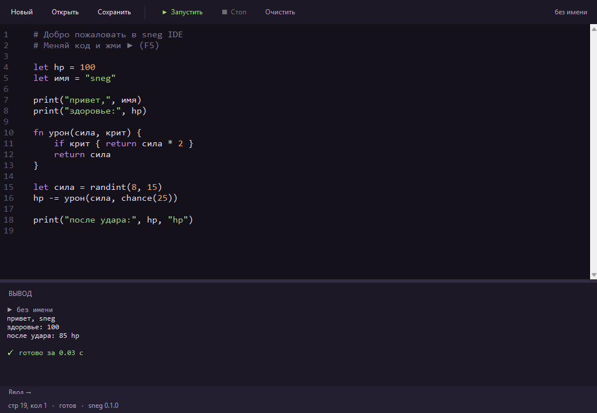

# sneg

Маленький встраиваемый язык программирования, написанный на Python.
Синтаксис — как у Python, но без ловушки с отступами; модель данных — как у Lua:
таблицы, функции как значения, замыкания.

Годится для консольных игр, прототипов и «бекендной» логики: роутер — это просто
таблица из строки в функцию.

```
sneg 0.1.0 · ~1800 строк · только стандартная библиотека Python
```

---

## Быстрый старт

```bash
python sneg.py examples/hello.sneg
python sneg.py                  # интерактивный режим (REPL)
python sneg.py --ast файл       # посмотреть дерево разбора
python sneg.py --tokens файл    # посмотреть поток токенов
```

## Готовое приложение: sneg.exe

В папке `dist` лежит собранный `sneg.exe` — 9 МБ, Python для запуска не нужен:

```
sneg.exe                       открыть REPL
sneg.exe программа.sneg        выполнить файл
sneg.exe --check файл          только проверить синтаксис
sneg.exe --compile файл        собрать .snegc
sneg.exe файл.snegc            запустить скомпилированное
sneg.exe -i файл.sneg          выполнить и остаться в REPL с его переменными
```

**Окно не захлопывается.** Если запустить exe двойным кликом или перетащить на него файл, после работы программа ждёт Enter — иначе консоль исчезла бы вместе с выводом. Из терминала никакого ожидания нет: там окно никуда не денется.

Управление поведением:

```
sneg.exe --pause файл          ждать Enter всегда
sneg.exe --no-pause файл       никогда не ждать
sneg.exe --who-am-i            показать, из какой программы запущено
```

Плюс переменная окружения `SNEG_NO_PAUSE=1`, если ожидание мешает в скриптах.

Собрать заново (после правок в `sneg.py`):

```bash
python -m pip install pyinstaller
python make_icon.py icon.ico
python -m PyInstaller --onefile --console --name sneg --icon icon.ico sneg.py
```

## Редактор с кнопкой «Запустить»

`dist\sneg-ide.exe` — окно с редактором, подсветкой и кнопкой ▶.



* **F5** — запустить, **Shift+F5** — остановить (работает даже с `while true`);
* **Ctrl+S / Ctrl+O / Ctrl+N** — сохранить, открыть, новый файл;
* вывод и ошибки — в панели «ВЫВОД», с временем выполнения;
* `input()` спрашивает строку в поле «Ввод →» под консолью;
* номера строк и подсветка ключевых слов, строк, чисел и комментариев.

Без exe: `sneg-ide.bat` или `python sneg_ide.py файл.sneg`.

Сборка IDE требует отдельного шага: в этом Python библиотеки Tcl/Tk лежат внутри виртуальной файловой системы, и PyInstaller их не видит.

```bash
python bundle_tcl.py
python -m PyInstaller --onefile --windowed --name sneg-ide --icon icon.ico ^
    --add-data "build_tcl\tcl_library;_tcl_data" ^
    --add-data "build_tcl\tk_library;_tk_data" sneg_ide.py
```

Первая программа — `hello.sneg`:

```sneg
print("привет, мир")

let имя = "sneg"
print("привет, " + имя + "!")

fn квадрат(x) {
    return x * x
}

print(квадрат(7))          # 49
```

---

## Синтаксис

### Переменные

```sneg
let hp = 100          # объявление
hp = hp - 30          # присваивание
hp -= 10              # то же короче
```

Переменную нужно объявить через `let` — иначе ошибка «не объявлена». Это ловит
опечатки вроде `hpp` сразу, а не через двадцать строк.

### Типы

| Тип | Примеры | Примечание |
|---|---|---|
| number | `42`, `3.5`, `-7` | внутри всегда float, но целые печатаются без `.0` |
| string | `"sneg"`, `'ok'` | экранирование: `\n`, `\t`, `\"`, `\\` |
| bool | `true`, `false` | |
| nil | `nil` | «ничего» |
| list | `[1, 2, 3]` | растёт через `push` |
| map | `{ имя: "sneg", hp: 100 }` | ключи всегда строки |
| function | `fn (x) { return x }` | функция — такое же значение, как число |

Ложны **только** `nil` и `false`. Ноль и пустая строка — истинны, как в Lua.

### Операторы

```sneg
1 + 2          # 3
"a" + 5        # "a5"  — плюс со строкой склеивает
7 / 2          # 3.5
7 % 2          # 1
1 < 2          # true
"a" == "a"     # true
not false      # true
1 == 1.0       # true
2 in [1, 2, 3] # true
"key" in { key: 1 }   # true
```

Логика: `and`, `or`, `not` (или `&&`, `||`, `!`). `and`/`or` возвращают сам
операнд, поэтому работает идиома `nil or "по умолчанию"`.

### Условия и циклы

```sneg
if hp <= 0 {
    print("мёртв")
} elseif hp < 20 {
    print("на грани")
} else {
    print("в порядке")
}

while hp > 0 {
    hp -= 10
}

for item in [10, 20, 30] {
    print(item)
}

for i in range(0, 5) {
    if i == 2 { continue }
    if i == 4 { break }
    print(i)                 # 0 1 3
}
```

`range(a, b, шаг)` не создаёт список — это ленивый диапазон, можно писать
`range(0, 1000000)`.

### Функции

```sneg
fn скидка(цена, процент) {
    return цена * (1 - процент / 100)
}

let сумма = скидка(1000, 10)        # 900

# функция как значение
let двойной = fn (x) { return x * 2 }
print(двойной(21))                  # 42

# замыкание: функция помнит окружение, в котором родилась
fn счётчик() {
    let n = 0
    return fn () {
        n += 1
        return n
    }
}

let c = счётчик()
print(c(), c(), c())                # 1 2 3
```

### Таблицы как объекты

```sneg
let игрок = { имя: "sneg", hp: 100, инвентарь: [] }

print(игрок.имя)          # sneg
игрок.hp -= 30            # изменение поля
print(игрок["hp"])        # 70 — то же самое
print(игрок.мана)         # nil — нет такого поля

push(игрок.инвентарь, "нож")
print(len(игрок.инвентарь))
```

### Комментарии

```sneg
# до конца строки
// тоже до конца строки
/* блочный
   на несколько строк */
```

### По-русски тоже можно

Ключевые слова имеют русские псевдонимы: `пусть`, `функция`, `если`,
`иначе_если`, `иначе`, `пока`, `для`, `в`, `вернуть`, `прервать`, `продолжить`,
`истина`, `ложь`, `ничего`, `и`, `или`, `не`.

```sneg
пусть hp = 100
если hp > 50 {
    print("ещё живой")
}
```

---

## Встроенные функции

| Функция | Что делает |
|---|---|
| `print(...)` | печатает значения через пробел |
| `input(подсказка?)` | читает строку; при конце ввода возвращает `nil` |
| `type(x)` | `"number"`, `"string"`, `"list"`, `"map"`, `"function"`, `"nil"` |
| `str(x)` / `num(x)` | в строку / в число (`num` вернёт `nil`, если не получилось) |
| `len(x)` | длина строки, списка, таблицы, диапазона |
| `push(list, v)` / `pop(list)` | добавить в конец / снять с конца |
| `insert(list, i, v)` / `remove(list, v)` | вставить / удалить по значению |
| `sort(list)` | сортирует на месте |
| `keys(map)` / `values(map)` / `has(map, k)` / `delete(map, k)` | работа с таблицей |
| `range(...)` | диапазон: `range(5)`, `range(1, 10)`, `range(0, 10, 2)` |
| `abs`, `floor`, `ceil`, `round`, `sqrt`, `min`, `max` | математика |
| `random()`, `randint(a, b)`, `chance(p)` | случайность; `chance(20)` — «20% да» |
| `upper`, `lower`, `split(s, sep)`, `join(list, sep)` | строки |
| `clock()` | секунды с 1970-го |
| `assert(условие, текст?)` | падает с сообщением, если условие ложно |
| `error(текст)` | самому бросить ошибку |
| `exit(код)` | выйти |

---

## Ошибки

Ошибка показывает место и подсвечивает символ:

```
❌ Ошибка в hello.sneg: переменная 'hp' не объявлена — сначала объяви её через let

  строка 4
    print(hp)
          ^
```

Внутри функции добавляется стек вызовов:

```
  стек вызовов:
    в функции boom(), вызвана на строке 12
```

---

## Встраивание в Python

```python
from sneg import Builtin, Interpreter, run_source, to_string

machine = Interpreter()

# отдаём в язык свою функцию
machine.globals.define(
    "log",
    Builtin("log", lambda args, line, col: print("[log]", *map(to_string, args))),
)

run_source('''
    log("старт")
    print(2 + 2)
''', interp=machine)
```

Так игра на Python может держать логику в `.sneg`-файлах и перезагружать их без
перезапуска.

---

## Примеры

| Файл | Что показывает |
|---|---|
| `examples/hello.sneg` | основы: переменные, функции, списки, циклы |
| `examples/guess.sneg` | интерактив: ввод, цикл, `break`/`continue` |
| `examples/cases.sneg` | симулятор кейсов: таблицы, веса, матожидание |
| `examples/arena.sneg` | пошаговый бой: объекты, случайность, условие выхода |
| `examples/backend.sneg` | «бекенд»: роутер из таблицы, ответы 200/404/400 |

---

## Тесты

```bash
python -m unittest discover -s tests
```

50 тестов: арифметика, области видимости, замыкания, рекурсия, коллекции,
встроенные функции и тексты ошибок.

---

## Чего пока нет

* классов и наследования — вместо них таблицы плюс функции (как в Lua);
* `try/catch` — `error()` останавливает программу;
* модулей и `import`;
* отдельных целых чисел (внутри всё float, как в Lua 5.3+);
* стандартной библиотеки сверх встроенных функций.

Порядок работ, если захочется продолжить: `import` файлов → `try/catch` →
синтаксический сахар для классов → `json` и `http` в стандартной библиотеке.
